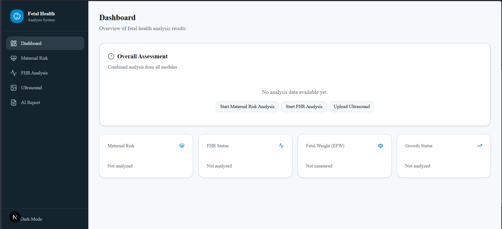
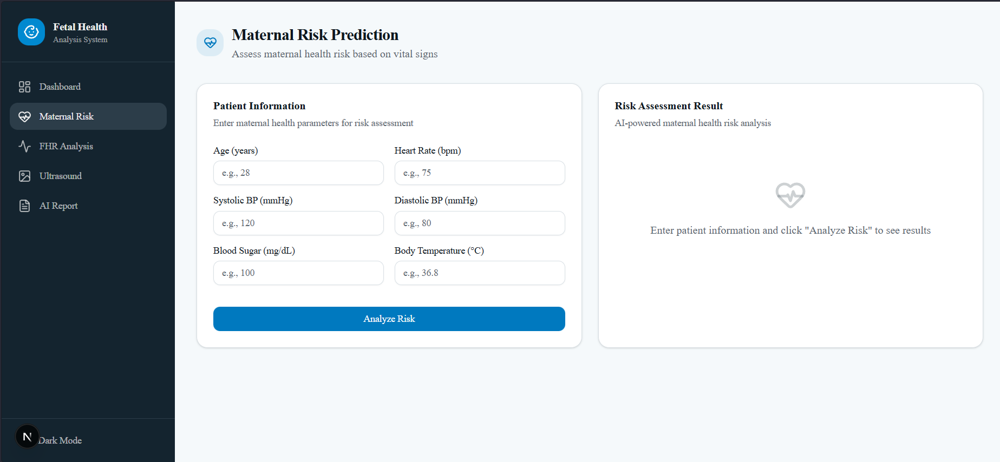
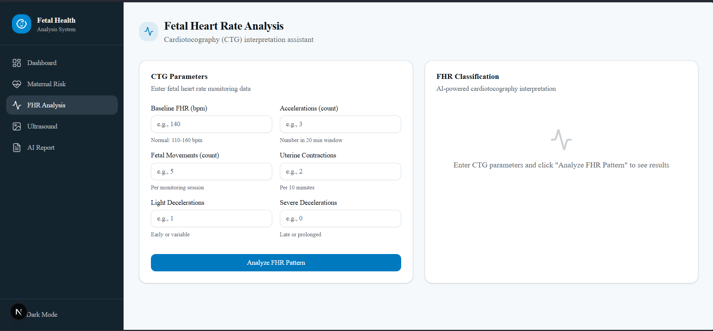
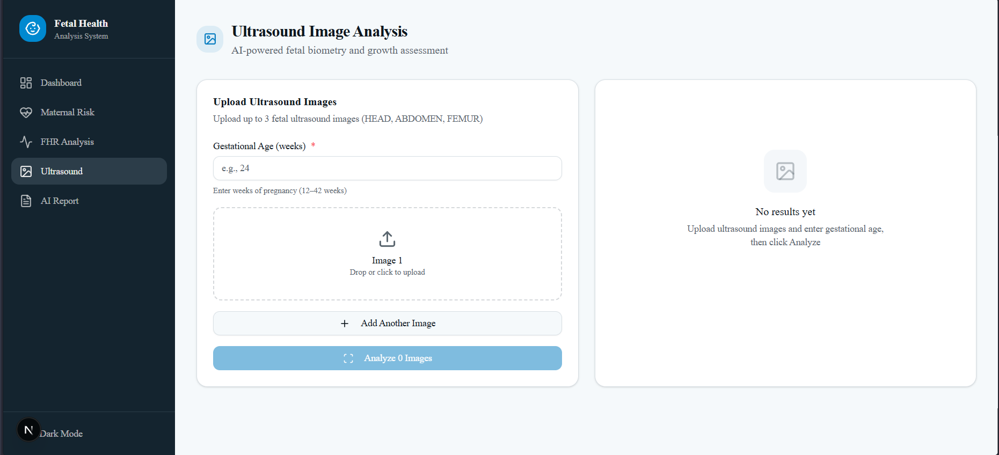
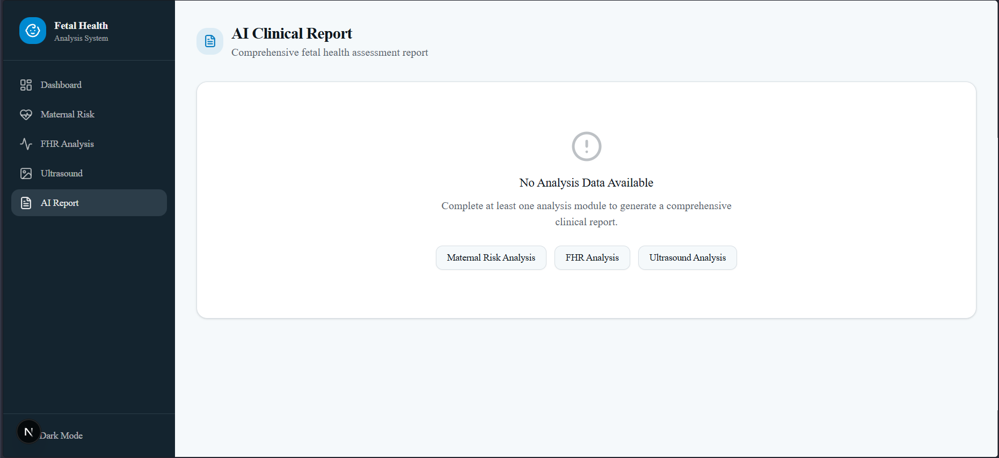
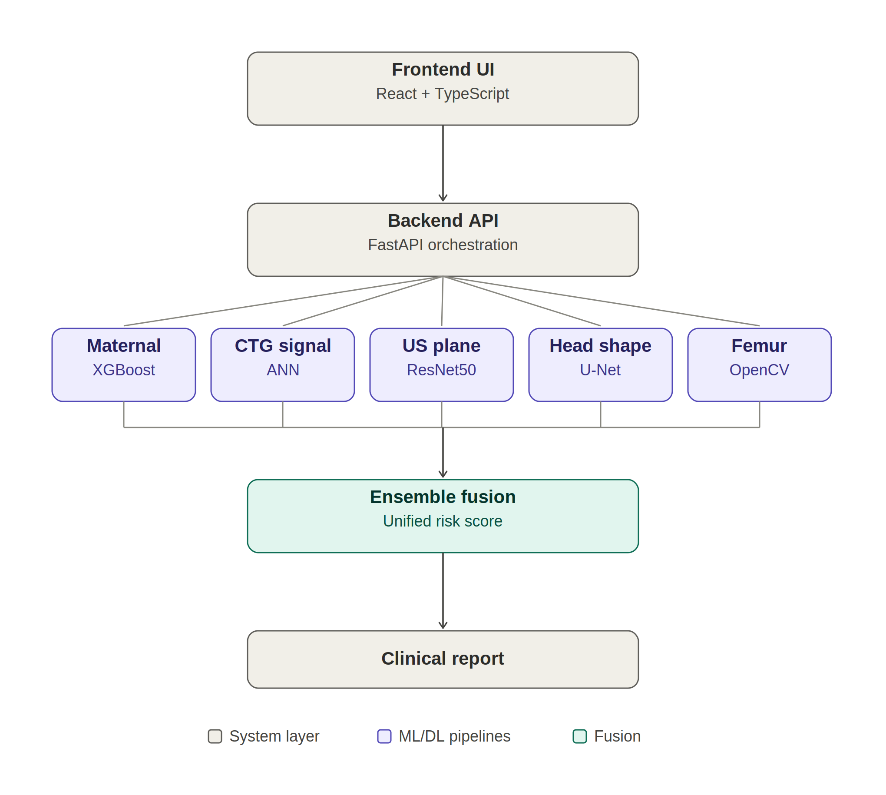

<div align="center">

#  Fetal Health Analysis Platform
### AI-Powered Clinical Decision Support for Maternal & Fetal Health

*A full-stack healthcare AI system combining machine learning, deep learning, computer vision, and modern web engineering to support prenatal risk assessment.*

[](#tech-stack)
[](#tech-stack)
[](#tech-stack)
[](#tech-stack)
[](#license)

[Demo Video](https://drive.google.com/file/d/1tDOiBD4-HCEmggOax7Q0tDK33VmeIyC7/view?usp=drive_link) · [Features](#-project-highlights) · [Architecture](#-system-architecture) · [Pipelines](#-machine-learning--deep-learning-pipelines) · [Tech Stack](#-tech-stack)

</div>

---

##  Overview

Prenatal care depends on interpreting several independent data sources — maternal vitals, fetal heart-rate monitoring, and ultrasound imaging — often across disconnected tools. **This platform unifies all three into a single clinical dashboard**, using five purpose-built ML, DL, and classical CV pipelines to turn raw clinical data into actionable, real-time risk assessments.

Built end-to-end (data pipeline → model training → inference services → production UI), the project demonstrates the full lifecycle of applied AI: from a Kaggle-grade research notebook to a deployable, API-driven web application.

---

##  Project Highlights

- **Full-stack healthcare AI platform** — Next.js + TypeScript frontend, FastAPI + Python backend
- **5 independent pipelines** — spanning classical ML, deep learning, and classical computer vision — unified into one clinical dashboard
- **Maternal Risk Prediction** — XGBoost classifier on clinical vitals
- **CTG Fetal Health Classification** — custom ANN trained on cardiotocography signals, with deliberate class-imbalance tuning for clinical safety
- **Ultrasound Plane Classification** — ResNet50 (transfer learning) with **Grad-CAM explainability**, so predictions are interpretable, not black-box
- **Fetal Head Segmentation** — U-Net for pixel-level anatomical structure detection
- **Femur Length Measurement** — classical OpenCV pipeline (CLAHE + Canny + Hough Line Transform) that geometrically measures femur length from segmented ultrasound frames, no additional model required
- **Modular FastAPI microservices** for real-time, independently-scalable model inference
- **AI-generated clinical reports** synthesizing outputs from all five pipelines into one summary

---

##  Problem Statement

Prenatal healthcare requires synthesizing multiple, heterogeneous data types — clinical vitals, time-series fetal heart monitoring, and medical imaging — to make timely risk decisions. This platform acts as an intelligent decision-support layer that:

- Predicts maternal health risk from vitals
- Classifies fetal health status from CTG data
- Detects fetal anatomical planes in ultrasound scans
- Segments fetal anatomical structures for biometric measurement
- Delivers every result through a unified, modern web interface

---

##  Demo

| | |
|---|---|
| **Dashboard** — combined assessment across all modules |  |
| **Maternal Risk Prediction** — AI-powered classification from vitals (Age, BP, Blood Sugar, Heart Rate, Body Temp) |  |
| **Fetal Heart Rate (CTG) Analysis** — classify fetal health from Baseline FHR, Accelerations, Decelerations |  |
| **Ultrasound Image Analysis** — upload Head / Abdomen / Femur scans for plane classification & biometry |  |
| **AI Clinical Report** — consolidated report across all modules |  |

 **[Watch the full demo video](https://drive.google.com/file/d/1tDOiBD4-HCEmggOax7Q0tDK33VmeIyC7/view?usp=drive_link)**



---

##  System Architecture
```mermaid
%% Generated by https://gitdiagram.com/priyankshu-07/alma
flowchart TD

subgraph group_frontend["Clinical dashboard"]
  node_dashboard["Dashboard<br/>[page.tsx]"]
  node_maternal_ui["Maternal assessment<br/>[page.tsx]"]
  node_fhr_ui["FHR assessment<br/>[page.tsx]"]
  node_ultrasound_ui["Ultrasound assessment<br/>[page.tsx]"]
  node_report_ui["Clinical report<br/>[page.tsx]"]
  node_app_state["Assessment state<br/>[app-context.tsx]"]
end

subgraph group_api["API orchestration"]
  node_api_backend["FastAPI backend<br/>[main.py]"]
  node_report_service["Report endpoint<br/>[main.py]"]
end

subgraph group_analysis["Clinical analysis"]
  node_maternal_model["Maternal risk model<br/>[maternal.py]"]
  node_fhr_model["CTG classifier<br/>[fhr.py]"]
  node_plane_classifier["Plane classifier<br/>[classify.py]"]
  node_head_segmenter["Head segmentation<br/>[head.py]"]
  node_femur_measure["Femur measurement<br/>[femur.py]"]
  node_hadlock["Growth assessment<br/>[hadlock.py]"]
end

subgraph group_reporting["Assessment and reporting"]
  node_aggregator["Result aggregation"]
  node_ai_report["AI report generation"]
end

node_clinical_user(("Clinical user"))

node_clinical_user -->|"uses"| node_dashboard
node_clinical_user -->|"enters vitals"| node_maternal_ui
node_clinical_user -->|"enters CTG"| node_fhr_ui
node_clinical_user -->|"uploads scans"| node_ultrasound_ui
node_dashboard -->|"reads"| node_app_state
node_maternal_ui -.->|"submits assessment"| node_api_backend
node_fhr_ui -.->|"submits assessment"| node_api_backend
node_ultrasound_ui -.->|"submits images"| node_api_backend
node_api_backend -->|"predicts risk"| node_maternal_model
node_api_backend -->|"classifies CTG"| node_fhr_model
node_api_backend -->|"classifies plane"| node_plane_classifier
node_api_backend -->|"measures head"| node_head_segmenter
node_api_backend -->|"measures femur"| node_femur_measure
node_plane_classifier -->|"routes head plane"| node_head_segmenter
node_plane_classifier -->|"routes femur plane"| node_femur_measure
node_head_segmenter -.->|"supports growth assessment"| node_hadlock
node_maternal_ui -.->|"updates results"| node_app_state
node_fhr_ui -.->|"updates results"| node_app_state
node_ultrasound_ui -.->|"updates results"| node_app_state
node_app_state -->|"provides combined status"| node_dashboard
node_report_ui -->|"reads assessments"| node_app_state
node_report_ui -.->|"requests report"| node_report_service
node_report_service -->|"aggregates results"| node_aggregator
node_report_service -->|"generates report"| node_ai_report
node_aggregator -->|"supplies combined findings"| node_ai_report
node_aggregator -.->|"returns priority and findings"| node_report_ui
node_ai_report -.->|"returns narrative"| node_report_ui

click node_dashboard "https://github.com/priyankshu-07/alma/blob/main/Frontend/app/page.tsx"
click node_maternal_ui "https://github.com/priyankshu-07/alma/blob/main/Frontend/app/maternal-risk/page.tsx"
click node_fhr_ui "https://github.com/priyankshu-07/alma/blob/main/Frontend/app/fhr/page.tsx"
click node_ultrasound_ui "https://github.com/priyankshu-07/alma/blob/main/Frontend/app/ultrasound/page.tsx"
click node_report_ui "https://github.com/priyankshu-07/alma/blob/main/Frontend/app/report/page.tsx"
click node_app_state "https://github.com/priyankshu-07/alma/blob/main/Frontend/lib/app-context.tsx"
click node_api_backend "https://github.com/priyankshu-07/alma/blob/main/BACKEND/main.py"
click node_maternal_model "https://github.com/priyankshu-07/alma/blob/main/BACKEND/services/maternal.py"
click node_fhr_model "https://github.com/priyankshu-07/alma/blob/main/BACKEND/services/fhr.py"
click node_plane_classifier "https://github.com/priyankshu-07/alma/blob/main/BACKEND/services/classify.py"
click node_head_segmenter "https://github.com/priyankshu-07/alma/blob/main/BACKEND/services/head.py"
click node_femur_measure "https://github.com/priyankshu-07/alma/blob/main/BACKEND/services/femur.py"
click node_hadlock "https://github.com/priyankshu-07/alma/blob/main/BACKEND/services/hadlock.py"
click node_aggregator "https://github.com/priyankshu-07/alma/blob/main/BACKEND/services/report_aggregator.py"
click node_ai_report "https://github.com/priyankshu-07/alma/blob/main/BACKEND/services/ai_report_service.py"
click node_report_service "https://github.com/priyankshu-07/alma/blob/main/BACKEND/main.py"

classDef toneNeutral fill:#f8fafc,stroke:#334155,stroke-width:1.5px,color:#0f172a
classDef toneBlue fill:#dbeafe,stroke:#2563eb,stroke-width:1.5px,color:#172554
classDef toneAmber fill:#fef3c7,stroke:#d97706,stroke-width:1.5px,color:#78350f
classDef toneMint fill:#dcfce7,stroke:#16a34a,stroke-width:1.5px,color:#14532d
classDef toneRose fill:#ffe4e6,stroke:#e11d48,stroke-width:1.5px,color:#881337
classDef toneIndigo fill:#e0e7ff,stroke:#4f46e5,stroke-width:1.5px,color:#312e81
classDef toneTeal fill:#ccfbf1,stroke:#0f766e,stroke-width:1.5px,color:#134e4a
class node_dashboard,node_maternal_ui,node_fhr_ui,node_ultrasound_ui,node_report_ui,node_app_state,node_clinical_user toneBlue
class node_api_backend,node_report_service toneAmber
class node_maternal_model,node_fhr_model,node_plane_classifier,node_head_segmenter,node_femur_measure,node_hadlock toneMint
class node_aggregator,node_ai_report toneRose


[](https://gitdiagram.com/priyankshu-07/alma?utm_source=readme&utm_medium=badge)


> **Femur measurement, unpacked:** once the ResNet50 classifier tags a frame as a "Femur" plane, that frame is routed to a **deterministic OpenCV pipeline** — not a second neural network. CLAHE contrast enhancement + Gaussian blur clean up the ultrasound noise, Canny edge detection finds bone boundaries, and a probabilistic Hough Line Transform isolates the longest valid near-horizontal line (the femur shaft axis, filtered by angle and length bounds). The pixel length is then converted to millimeters via a fixed pixel-spacing calibration constant. It's a deliberate choice: femur length is a well-defined geometric measurement, so a classical CV algorithm gives a fast, deterministic, and fully explainable result — no training data or GPU inference needed for this step.

---

##  Model Performance

| Pipeline | Model | Metric | Result |
|---|---|---|---|
| Maternal Risk Prediction | XGBoost | Test Accuracy | **81.77%** |
| CTG Fetal Health Classification | ANN | Test Accuracy | **~80%** (macro F1: 0.632) |
| Ultrasound Plane Classification | ResNet50 | Accuracy | **93.0%** |
| Fetal Head Segmentation | U-Net | IoU | **95.66%** |
| Femur Length Measurement | Classical CV (OpenCV) | Method | Deterministic geometric measurement — no accuracy metric applies |

> **Engineering note:** the CTG/ANN model's raw accuracy peaked higher, but the initial version recognized only **5.71%** of true Pathological cases — an unacceptable miss rate for a clinical-safety-critical class. Iterative `class_weight` tuning traded a small amount of overall accuracy for a **7× improvement in Pathological recall (5.71% → 40%)**, prioritizing the metric that actually matters in this domain: not missing high-risk cases.

---

##  Machine Learning, Deep Learning & Computer Vision Pipelines

### 1. Maternal Health Risk Prediction
**Objective:** Predict maternal health risk level from clinical vitals.
**Input Features:** Age, Systolic BP, Diastolic BP, Blood Glucose, Body Temperature, Heart Rate
**Model:** XGBoost Classifier
**Output:** Low Risk / Medium Risk / High Risk

### 2. CTG Fetal Health Classification
**Objective:** Classify fetal health status from cardiotocography (CTG) measurements.
**Model:** Artificial Neural Network (ANN), tuned for class-imbalance-aware recall on the clinically critical minority class.
**Output Classes:** Normal / Suspect / Pathological

### 3. Ultrasound Anatomical Plane Classification
**Objective:** Identify fetal anatomical planes from ultrasound images.
**Model:** ResNet50 (Transfer Learning)
**Explainability:** Grad-CAM visualization highlights the image regions driving each prediction
**Supported Planes:** Head / Abdomen / Femur / Other Fetal Planes

### 4. Fetal Head Segmentation
**Objective:** Generate pixel-level segmentation masks of fetal head regions.
**Model:** U-Net
**Applications:** Head circumference estimation, growth monitoring

### 5. Femur Length Measurement
**Objective:** Measure femur length (FL) from ultrasound frames already classified as the "Femur" plane.
**Approach:** Classical computer vision, not a trained model. Femur images are first segregated from the U-Net fetal-parts classification dataset, then processed through:
1. **CLAHE** (Contrast Limited Adaptive Histogram Equalization) to enhance bone contrast against ultrasound noise
2. **Gaussian blur** to suppress speckle noise
3. **Canny edge detection** to extract bone boundaries
4. **Probabilistic Hough Line Transform** to detect candidate line segments, filtered by angle (rejecting near-vertical lines) and length bounds to isolate the true femur shaft axis
5. **Pixel-to-mm conversion** via a fixed pixel-spacing calibration constant to output the final `FL_mm`

**Why classical CV instead of another model:** femur length is a well-defined geometric measurement once the bone is visible — a deterministic algorithm is faster, fully explainable, and needs no additional labeled training data, unlike a learned segmentation or regression model.

---

## 🛠️ Tech Stack

| Layer | Technologies |
|---|---|
| Frontend | Next.js, TypeScript, React, Tailwind CSS |
| Backend | FastAPI, Python |
| Machine Learning | XGBoost, Scikit-Learn |
| Deep Learning | TensorFlow / Keras, PyTorch |
| Computer Vision | OpenCV, Grad-CAM |
| Data Processing | NumPy, Pandas |

---

##  Project Structure

```
FETAL-HEALTH/
│
├── Backend/
│   ├── main.py
│   └── services/
│       ├── maternal.py
│       ├── fhr.py
│       ├── classify.py
│       ├── head.py
│       ├── femur.py
│       └── hadlock.py
│
├── FRONTEND/
│   ├── app/
│   ├── components/
│   ├── hooks/
│   ├── lib/
│   └── styles/
│
├── Models/
│   ├── best_model.pkl
│   ├── fetal_health_ann_model.h5
│   ├── resnet50_fetal_planes.pth
│   └── head.pth
│
├── Notebooks/
│   ├── MHRP_XGBoost.ipynb
│   ├── FetalHealthrate.ipynb
│   ├── UltrasoundImage+femur.ipynb
│   └── Head.ipynb
│
├── demo/
│   ├── dashboard.png
│   ├── maternal_risk.png
│   ├── fhr_analysis.png
│   ├── ultrasound.png
│   └── ai_report.png
│
└── README.md
```

---

##  Technical Challenges & Solutions

| Challenge | How it was addressed |
|---|---|
| Heterogeneous healthcare datasets (tabular + time-series + image) | Built separate, purpose-fit pipelines per modality instead of forcing one model architecture |
| Multiple ML/DL model types in one workflow | Standardized on modular FastAPI inference services, each independently deployable |
| Severe class imbalance in CTG data (Pathological cases rare) | Iteratively tuned `class_weight` strategies to prioritize recall on the clinically critical class over raw accuracy |
| Ultrasound image preprocessing at scale | OpenCV-based preprocessing pipeline feeding a ResNet50 transfer-learning model |
| Model interpretability for clinical trust | Integrated Grad-CAM so predictions are visually explainable, not black-box |
| Integrating segmentation + classification pipelines | Unified output schema so the frontend renders both under one dashboard |
| Measuring femur length without a dedicated regression model | Segregated femur frames from the classification dataset and built a classical OpenCV pipeline (CLAHE → Canny → Hough Line Transform) with angle/length filtering to isolate the correct bone-axis line |

---

##  Future Enhancements

- RAG-powered AI Clinical Assistant for guideline-grounded Q&A
- Medical guideline retrieval using vector databases
- LangChain-based conversational interface
- DICOM image support
- Gestational age estimation
- Cloud deployment via Docker + Kubernetes
- Hospital system integration via HL7/FHIR standards

---

##  License

Released under the [MIT License](LICENSE).

---

<div align="center">

**Built to demonstrate end-to-end applied AI engineering — from raw clinical data to a production-ready clinical dashboard.**

</div>
